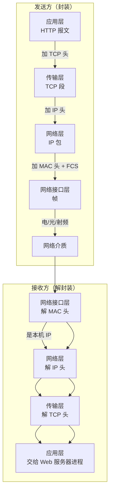

# TCP/IP 四层网络模型笔记

> 原 `文档/TCP_IP四层网络模型有哪几层.md` 的重写。原笔记是图解风格但外部图片链接（nlark CDN）已失效，本笔记**重画所有图**（ASCII / Mermaid）、**补全 OSI 对应关系、IPv6、CIDR、NAT 等现代概念**，并把日常排查工具串起来。

## 目录

1. 为什么要分层
2. 四层模型 + 与 OSI 七层对应
3. 应用层（HTTP / DNS / SMTP 等 + 端口速查）
4. 传输层（TCP vs UDP）
5. 网络层（IPv4 / IPv6 / CIDR / NAT）
6. 网络接口层（以太网 / MAC / ARP / MTU）
7. 数据封装 / 解封装流程图
8. 常见排查工具速查

---

## 1. 为什么要分层

### 1.1 分层的核心动机

**解耦 + 标准化 + 可替换**：

- **解耦**：每层只关心"下一层能给我什么"，不关心怎么实现
- **标准化**：接口统一，不同厂商实现可互操作（如不同操作系统的 TCP 实现）
- **可替换**：物理层从网线换成光纤，IP 层无需改动

### 1.2 类比：寄快递

```
寄件人  ──应用层──► 写快递单（应用数据）
        ──传输层──► 标注发件城市、目的城市（TCP 段）
        ──网络层──► 走哪条运输路线（IP 包）
        ──接口层──► 上哪辆车 / 哪个航班（帧）
```

接收方反过来：**拆快递**——自底向上层层解封装。

---

## 2. 四层模型 + 与 OSI 七层对应

### 2.1 TCP/IP 四层模型（实际使用）

```
┌──────────────────────────────────────────┐
│  应用层  Application Layer                │  ← HTTP, DNS, SMTP, FTP, SSH, WebSocket
├──────────────────────────────────────────┤
│  传输层  Transport Layer                  │  ← TCP, UDP（端口、连接、可靠性）
├──────────────────────────────────────────┤
│  网络层  Internet Layer                   │  ← IP, ICMP, ARP, IGMP（IP 地址、路由）
├──────────────────────────────────────────┤
│  网络接口层  Link Layer                   │  ← 以太网、Wi-Fi、PPP、MAC 地址、帧
└──────────────────────────────────────────┘
```

### 2.2 每层的数据单元（PDU）命名

| 层 | 数据单元 | 类比 |
|---|---|---|
| 应用层 | 报文 / Message | 信纸内容 |
| 传输层 | 段 / Segment | 装好信封，贴邮票 |
| 网络层 | 包 / Packet / Datagram | 写好发件人/收件人地址，套多个信封 |
| 网络接口层 | 帧 / Frame | 装进快递车 |

> 这些术语**没有本质区别**，统称"数据包"也无妨；区分名字主要是为了说清楚「我现在说的是哪一层的事」。

### 2.3 OSI 七层模型（教学/理论）

OSI 是 ISO 的理论模型，TCP/IP 是实际在用的协议栈。两者对应：

```
OSI 七层              TCP/IP 四层
─────────────────     ─────────────
7 应用层  Application ┐
6 表示层  Presentation ├── 应用层
5 会话层  Session     ┘
4 传输层  Transport  ──── 传输层
3 网络层  Network    ──── 网络层
2 数据链路层 Data Link ┐
1 物理层  Physical    ┘─── 网络接口层
```

**实际工程只看 TCP/IP 四层。** OSI 的"表示层/会话层"在 TCP/IP 中没有独立对应，被吸收进应用层。

---

## 3. 应用层

### 3.1 定位

最贴近用户的一层。**应用进程**通过这一层协议完成具体业务。

### 3.2 常见协议

| 协议 | 端口 | 用途 |
|---|---|---|
| **HTTP** | 80 | 超文本传输（明文） |
| **HTTPS** | 443 | HTTP + TLS 加密 |
| **DNS** | 53 | 域名 → IP 解析（UDP 为主，大响应走 TCP） |
| **SSH** | 22 | 加密远程登录 |
| **Telnet** | 23 | 明文远程登录（**不安全，已淘汰**） |
| **FTP** | 20/21 | 文件传输（**明文，已少用**，改 SFTP） |
| **SMTP** | 25 | 邮件发送 |
| **POP3** | 110 | 邮件收取（下载到本地） |
| **IMAP** | 143 | 邮件收取（服务器保留副本） |
| **WebSocket** | 80/443 | 全双工长连接（`ws://`/`wss://`） |
| **gRPC** | 任意 | 基于 HTTP/2 的 RPC |
| **NTP** | 123 | 时间同步 |

> 端口范围：0~65535。其中 0~1023 是"知名端口"，需 root 才能绑定。

---

## 4. 传输层

### 4.1 定位

为应用层提供**端到端**的通信——区分同一个 IP 上的不同应用（用端口号），保证数据可靠或快速送达。

### 4.2 TCP vs UDP 对比

| 维度 | TCP | UDP |
|---|---|---|
| 连接性 | 面向连接（三次握手） | 无连接 |
| 可靠性 | 可靠（ACK + 重传 + 排序） | 不可靠（发了就忘） |
| 顺序 | 保证有序 | 不保证 |
| 流量控制 | ✅ 滑动窗口 | ❌ |
| 拥塞控制 | ✅（慢启动、拥塞避免） | ❌ |
| 头部开销 | 20 字节 | 8 字节 |
| 传输效率 | 相对低 | 高 |
| 实时性 | 相对差 | 好 |
| 适用 | HTTP、SSH、文件传输、邮件 | DNS、视频、直播、游戏、VoIP |

> "**用 UDP 实现可靠传输**" 可以，但要在应用层重做 ACK/重传/排序——QUIC 协议（HTTP/3 底层）就是这样做。

### 4.3 TCP 三次握手（建立连接）

```
客户端                    服务端
  │  ──── SYN seq=x ────►  │
  │  ◄── SYN seq=y, ACK=x+1 ──  │     第一次握手
  │  ──── ACK=y+1 ────►      │     第二次握手
  │                          │     第三次握手
  │  ──── 数据传输 ────►     │
```

> 三次握手是为了**双方都确认对方收发正常**。两次不够（服务端无法确认客户端收到自己的 SYN-ACK），四次浪费。

### 4.4 TCP 四次挥手（关闭连接）

```
客户端                    服务端
  │  ──── FIN ────►          │     客户端：我发完了
  │  ◄── ACK ──              │     服务端：知道了（此时客户端 → 服务端方向关闭）
  │                          │
  │  ◄── FIN ──              │     服务端也发完了
  │  ──── ACK ────►          │     客户端：知道了（服务端 → 客户端方向也关闭）
```

> 为什么是四次？因为 TCP 是**全双工**，两个方向要独立关闭。FIN/ACK 可以合并，但标准做法是分开。

### 4.5 MSS 与 MTU

- **MSS**（Maximum Segment Size）：TCP 段最大数据长度，**不含 IP/TCP 头部**。典型 1460 字节
- **MTU**（Maximum Transmission Unit）：链路层一帧最大字节数，以太网默认 **1500 字节**
- 关系：`MSS = MTU - IP头(20) - TCP头(20) = 1460`

**为什么 IP 包过大要分片？** 超过 MTU 的 IP 包会被中间路由器**分片**，任何一个分片丢失都导致整个包要重传，效率低。TCP 通过 MSS 协商避免 IP 层分片。

### 4.6 端口（Port）

- 16 位整数，0~65535
- 一台机器的 IP 不变，靠端口区分不同应用
- 客户端的临时端口由 OS 分配（如 50000+）

```
http://10.0.0.1:8080/path
         │     │
         IP   端口
```

---

## 5. 网络层

### 5.1 定位

**跨网络**传输：把数据包从源主机送到目标主机。负责 IP 地址、路由、分片。

### 5.2 IPv4

- 地址长度：32 位，分 4 段（每段 8 位）
- 表示：`a.b.c.d`，每段 0~255
- 例：`192.168.1.100`
- 总数：约 43 亿（2011 年耗尽）

### 5.3 IPv6

- 地址长度：128 位，分 8 组（每组 16 位）
- 表示：`2001:0db8:85a3:0000:0000:8a2e:0370:7334`
- 简写：连续 0 段可省，如 `2001:db8:85a3::8a2e:370:7334`
- 总数：2^128 ≈ 3.4 × 10^38（**实质无限**）
- 优势：地址充足 / 内置 IPsec / 简化包头 / 邻居发现替代 ARP

### 5.4 子网掩码 / CIDR

**子网掩码**：把 IP 分成"网络号 + 主机号"两部分。

```
IP：       192.168.1.100
子网掩码：  255.255.255.0

按位 AND：
  192.168.1.100  = 11000000.10101000.00000001.01100100
  255.255.255.0  = 11111111.11111111.11111111.00000000
  ─────────────────────────────────────────────────
  按位与         = 11000000.10101000.00000001.00000000
                  = 192.168.1.0      ← 网络号
                  主机号 = .100
```

**CIDR 写法**（现代风格）：`192.168.1.0/24` 表示前 24 位是网络号（等价于子网掩码 `255.255.255.0`）。

| CIDR | 子网掩码 | 可用主机数 |
|---|---|---|
| `/8` | `255.0.0.0` | 16,777,214 |
| `/16` | `255.255.0.0` | 65,534 |
| `/24` | `255.255.255.0` | 254 |
| `/25` | `255.255.255.128` | 126 |
| `/30` | `255.255.255.252` | 2（点对点链路） |
| `/32` | `255.255.255.255` | 1（单主机） |

> 减 2 是因为第一个（网络地址）和最后一个（广播地址）不能用。

### 5.5 公网 IP vs 私有 IP

| 类型 | 范围 | 说明 |
|---|---|---|
| **公网 IP** | 全球唯一，可路由 | 需 ISP 分配或云厂商分配 |
| **私有 IP** | 仅局域网内可用 | 见下 |

IPv4 私有地址段（RFC 1918）：

```
10.0.0.0/8          (10.x.x.x)
172.16.0.0/12       (172.16~31.x.x)
192.168.0.0/16      (192.168.x.x)
```

### 5.6 NAT（网络地址转换）

**问题**：公网 IP 不够，每个设备分一个公网 IP 不现实。

**解法**：局域网内设备用私有 IP，**出口路由器**做 NAT，把私有 IP 翻译成公网 IP。

```
[PC: 192.168.1.10] ──► [家用路由器 NAT] ──► 公网 8.8.8.8
                      │ 
                  维护转换表：
                  {公网端口 50001 ↔ 内网 192.168.1.10:3000}
```

变体：

- **SNAT**：源地址转换（内网 → 外网，最常见）
- **DNAT**：目标地址转换（外网 → 内网，端口映射/端口转发）
- **PAT**：端口地址转换（家用路由器的"端口转发"功能）

### 5.7 路由

路由器根据**路由表**决定下一跳：

```
目标网络         下一跳           接口
0.0.0.0/0        192.168.1.1      eth0      ← 默认路由（default gateway）
10.0.0.0/8       10.0.0.1         eth1
192.168.1.0/24   0.0.0.0          eth0      ← 直连
```

### 5.8 ICMP

- Internet Control Message Protocol
- 用于**诊断和错误报告**
- 典型工具：`ping`（用 ICMP Echo Request/Reply）、`traceroute`（用 TTL 超时）

---

## 6. 网络接口层

### 6.1 定位

在同一**局域网**内，把数据包从一台机器送到另一台机器。**网络层负责跨网络，本层负责最后一段**。

### 6.2 以太网（Ethernet）

- 最主流的局域网技术
- 网线、Wi-Fi、交换机、网卡都属以太网范畴
- **MAC 地址**（48 位，6 字节）是设备在全球的唯一标识
- 格式：`00:1A:2B:3C:4D:5E`，前 24 位是厂商 OUI

### 6.3 ARP（IP → MAC）

同一局域网内，**只知道 IP 不够**，还要知道目标 MAC。ARP 把 IP 解析为 MAC：

```
A: "谁有 192.168.1.1 的 MAC？"（广播）
B（192.168.1.1）: "我的 MAC 是 00:1A:2B:3C:4D:5E"（单播回 A）
```

> 跨网段时，ARP 解析的是**默认网关**的 MAC。

### 6.4 帧格式

```
┌──────────┬──────────┬─────────┬─────────┬─────┐
│ 目的 MAC │ 源 MAC   │ 类型(2B)│  数据   │ FCS │
└──────────┴──────────┴─────────┴─────────┴─────┘
                                              └─ 校验
```

### 6.5 MTU 1500

以太网一帧最大 1500 字节（包含头部），超过要分片。这就是为什么 TCP MSS 选 1460。

### 6.6 交换机 vs 路由器

| 设备 | 工作在哪层 | 决策依据 |
|---|---|---|
| **交换机**（Switch） | 网络接口层（MAC） | 查 MAC 表，转发到对应端口 |
| **路由器**（Router） | 网络层（IP） | 查路由表，跨网段转发 |

家用路由器 = 交换机 + 路由器 + NAT + DHCP + Wi-Fi AP 的合体。

---

## 7. 数据封装 / 解封装流程图

### 7.1 发送方（自顶向下封装）

```
应用层  [HTTP 请求报文]            报文 Message
              │ 应用层加应用头
传输层  [TCP 头部 | HTTP 报文]     段 Segment
              │ 传输层加 TCP 头（src/dst port）
网络层  [IP 头 | TCP 段]           包 Packet
              │ 网络层加 IP 头（src/dst IP）
网络接口 [MAC 头 | IP 包 | FCS]    帧 Frame
              │ 加 MAC 头（src/dst MAC）+ 校验
         ↓↓↓ 转换为电信号/光信号/无线电波 ↓↓↓
```

### 7.2 接收方（自底向上解封装）

```
物理信号 → 帧 → 剥 MAC 头 → 包 → 剥 IP 头 → 段 → 剥 TCP 头 → 报文 → 交给应用
                                  ↑
                              检查 dst IP 是不是我？
                                  ↑
                              检查 dst MAC 是不是我？
```

### 7.3 完整流程示意



### 7.4 各层处理的关键字段

| 层 | 关键字段 | 用途 |
|---|---|---|
| 应用层 | URL、Method、Header、Body | 业务语义 |
| 传输层 | src port, dst port, seq, ack | 区分应用、保证顺序、流量控制 |
| 网络层 | src IP, dst IP, TTL, protocol | 跨网络路由、防环、标识上层协议 |
| 网络接口层 | src MAC, dst MAC, EtherType, FCS | 局域网寻址、帧校验 |

---

## 8. 常见排查工具速查

| 工具 | 层 | 用途 | 示例 |
|---|---|---|---|
| `ping` | 网络层 | 测试主机是否可达（ICMP Echo） | `ping 8.8.8.8` |
| `traceroute` / `tracert` | 网络层 | 显示到达目标经过的所有路由 | `traceroute google.com` |
| `nslookup` / `dig` | 应用层 | DNS 解析查询 | `dig baidu.com` |
| `curl -v` | 应用层 | 看 HTTP 握手、Headers、TLS 协商 | `curl -v https://example.com` |
| `netstat` / `ss` | 传输层 | 看本地监听端口 / 连接状态 | `ss -tlnp` |
| `lsof -i` | 传输层 | 看进程打开的网络连接 | `lsof -iTCP:8080` |
| `tcpdump` / `Wireshark` | 所有层 | **抓包**分析（终极工具） | `tcpdump -i eth0 port 80` |
| `ip addr` / `ifconfig` | 网络接口层 | 看网卡 / IP / MAC | `ip addr show eth0` |
| `ip route` | 网络层 | 看路由表 | `ip route` |
| `arp -a` | 网络接口层 | 看 IP-MAC 缓存 | `arp -a` |
| `mtr` | 网络层 | ping + traceroute 持续观察 | `mtr 8.8.8.8` |
| `nmap` | 应用/传输 | 端口扫描 | `nmap -sV -p 1-1000 host` |

### 排查思路（自底向上）

```
1. 网卡 / 网线   → ip addr / ethtool
2. 本机网络      → ping 127.0.0.1
3. 网关          → ping 192.168.1.1
4. 公网 DNS      → ping 8.8.8.8
5. 公网域名      → ping google.com
6. 端口连通性    → telnet host port / nc -zv host port
7. 应用层        → curl -v / tcpdump / Wireshark
```

> "能 ping 通但访问不了应用" → 网络层 OK，问题在传输层或应用层。
> "ping 不通网关" → 本机到路由器这段断，检查网线 / DHCP / 网卡。

---

## 关联笔记

- 应用层协议 WebSocket：`[[websocket笔记]]`
- 反向代理 / TLS 终止：`[[nginx]]`（如已收录）
- 网络安全（TLS / HTTPS 握手）：`[[jwt]]` / `[[前后端常用鉴权方式总结]]`
- 网关（更高层的网络入口）：`[[网关(gateway)]]`

## 总结口诀

```
应用层写数据（HTTP/JSON/...）
传输层贴端口（TCP/UDP）
网络层贴地址（IP）
链路层贴门牌（MAC）
发出去走一跳一跳到对家
拆信封反过来收到数据
```