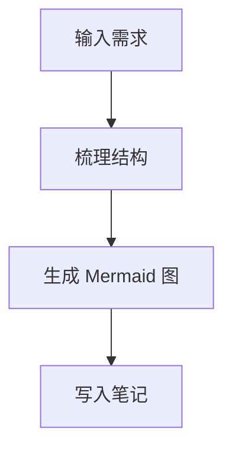

# Mermaid 可视化表达规范

## 规则

后续需要使用流程图、架构图等可视化内容时，默认优先使用 Mermaid 语法表达，而不是用纯文本字符串、ASCII 字符画、手写箭头缩进等方式模拟图形。

## 原因

- Mermaid 可以在 Obsidian 中直接渲染，适合知识库长期维护
- Mermaid 图比字符串图更容易修改、复用和版本管理
- 结构化图形语法能减少字符对齐、排版失效和跨编辑器显示不一致的问题

## 如何应用

### 1. 适用场景

- 流程图
- 系统架构图
- 模块依赖关系
- 调用链路
- 数据流向
- 决策分支
- 状态流转
- 时序交互
- 知识结构图

### 2. 默认优先级

- 能用 Mermaid 清晰表达的结构，优先使用 Mermaid
- 不使用字符串拼接、ASCII 字符画、手写箭头缩进来模拟图形
- 如果 Mermaid 不适合表达，优先考虑表格或有层次的列表
- 用户明确要求纯文本图时，按用户要求处理

### 3. 推荐图表类型

- 流程步骤：`flowchart TD`
- 横向架构：`flowchart LR` 或 `graph LR`
- 调用时序：`sequenceDiagram`
- 状态流转：`stateDiagram-v2`
- 分类结构：`mindmap`
- 时间规划：`timeline`
- 数据实体关系：`erDiagram`

## 示例

## 引用本规则的入口

详见根目录 `AGENTS.md` / `CLAUDE.md` 中的"Mermaid 可视化表达规范"小节。
