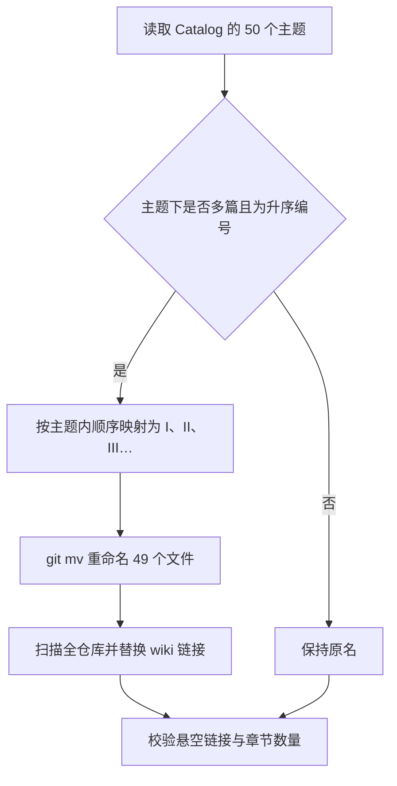

# 技术栈系列笔记编号改用罗马数字

## 目标与范围

[Catalog.md](../../Catalog.md) 已按技术主题平铺索引。本次把「同一主题下存在多篇、且使用升序数字前缀」的笔记，文件名前缀由 `01_`、`02_` 改为 `I_`、`II_`，按主题内顺序从 I 重新开始；不使用升序编号的、以及主题下只有单篇的笔记保持原名。

范围：49 个文件重命名 + 全仓库 `[[...]]` 链接同步替换。
不包含：笔记正文改写、`example/` 代码调整、修改 `Uncategorized` 中非升序编号文件的名称。

## 现状与关键决策

### 已确认的现状

| 项目 | 现状 |
|---|---|
| Catalog 结构 | 50 个 `##` 章节，49 篇笔记带 `NN_` 数字前缀 |
| 引用规模 | `Catalog.md` 49 处；约 40 个笔记文件内另有约 150 处交叉引用 |
| 主题与篇数 | 见下表 |
| `Git Worktree 笔记` | Git 主题下无编号的一篇，不参与改名 |
| `Cross-cutting Topics` | 编号为 01、03、04、08，非升序，按规则不处理 |
| 单篇主题 | MySQL、PostgreSQL、SQLite、MongoDB、Redis、Milvus、Qdrant、zvec、RabbitMQ、Kafka、Harbor、Process Management 等，各 1 篇，不处理 |
| 未归类 | 15 篇均无数字前缀 |

### 处理范围

| 主题 | 篇数 | 原编号 | 是否升序 |
|---|---|---|---|
| Go | 7 | 01–07 | 是 |
| CSS | 6 | 01–06 | 是 |
| Next.js | 6 | 01–06 | 是 |
| Docker | 5 | 01–05 | 是 |
| Linux | 5 | 01–05 | 是 |
| React | 4 | 01–04 | 是 |
| Kubernetes | 4 | 01–04 | 是 |
| JavaScript | 3 | 01–03 | 是 |
| Git | 3（另有 1 篇无编号） | 01–03 | 是 |
| Jenkins | 2 | 06–07 | 是，但起点非 1 |
| Machine Learning | 2 | 01、03 | 是，但不连续 |
| Large Language Models | 2 | 01–02 | 是 |

### 关键决策

| 编号 | 决策 | 说明 |
|---|---|---|
| A | 分隔符保持 `_`，只把数字换成罗马数字 | 与原命名风格一致，如 `01_CSS笔记.md` → `I_CSS笔记.md` |
| B | **Jenkins 的 06、07 改为 I、II** | 原编号是旧 CI/CD 大系列的第 6、7 篇，在独立 Jenkins 主题下已失去序列意义；按「从 1 开始」重编 |
| C | **Machine Learning 的 01、03 改为 I、II** | 原系列第 2 篇 `02_PyTorch笔记` 已归属 PyTorch 主题，本主题内按新顺序重编 |
| D | **Git 只改 3 篇有编号的**，`Git Worktree 笔记` 保持不变 | 该篇未采用数字编号，符合「没有采用升序编号的则不管」 |
| E | 单篇主题的编号前缀一律保留 | 如 `01_MySQL笔记`、`05_Harbor笔记`、`02_PyTorch笔记` 维持原名 |
| F | `Cross-cutting Topics` 的 01、03、04、08 不改 | 该主题内编号非升序，按规则不处理 |
| G | 重命名与链接替换作为同一次操作完成 | 中途中断会导致链接悬空，不做成两个可独立完成的任务 |

### 完整映射表

**Go（7）**

| 原名 | 新名 |
|---|---|
| 01_Go笔记 | I_Go笔记 |
| 02_Go基础语法笔记 | II_Go基础语法笔记 |
| 03_Go复合类型笔记 | III_Go复合类型笔记 |
| 04_Go函数笔记 | IV_Go函数笔记 |
| 05_Go面向对象笔记 | V_Go面向对象笔记 |
| 06_Go包与工程笔记 | VI_Go包与工程笔记 |
| 07_Go常见问题笔记 | VII_Go常见问题笔记 |

**CSS（6）**

| 原名 | 新名 |
|---|---|
| 01_CSS笔记 | I_CSS笔记 |
| 02_CSS选择器与继承笔记 | II_CSS选择器与继承笔记 |
| 03_CSS盒模型笔记 | III_CSS盒模型笔记 |
| 04_CSS布局笔记 | IV_CSS布局笔记 |
| 05_CSS单位与值笔记 | V_CSS单位与值笔记 |
| 06_CSS常见问题笔记 | VI_CSS常见问题笔记 |

**Next.js（6）**

| 原名 | 新名 |
|---|---|
| 01_Next.js 笔记 | I_Next.js 笔记 |
| 02_Next.js 路由笔记 | II_Next.js 路由笔记 |
| 03_Next.js Server与Client组件笔记 | III_Next.js Server与Client组件笔记 |
| 04_Next.js 数据获取与Server Actions笔记 | IV_Next.js 数据获取与Server Actions笔记 |
| 05_Next.js 渲染模式笔记 | V_Next.js 渲染模式笔记 |
| 06_Next.js 常见问题笔记 | VI_Next.js 常见问题笔记 |

**Docker（5）**

| 原名 | 新名 |
|---|---|
| 01_Docker笔记 | I_Docker笔记 |
| 02_Docker镜像与容器笔记 | II_Docker镜像与容器笔记 |
| 03_Docker数据卷与挂载笔记 | III_Docker数据卷与挂载笔记 |
| 04_Dockerfile笔记 | IV_Dockerfile笔记 |
| 05_Docker Compose笔记 | V_Docker Compose笔记 |

**Linux（5）**

| 原名 | 新名 |
|---|---|
| 01_Linux基础与文件管理笔记 | I_Linux基础与文件管理笔记 |
| 02_Linux用户权限与组管理笔记 | II_Linux用户权限与组管理笔记 |
| 03_Linux进程服务与系统管理笔记 | III_Linux进程服务与系统管理笔记 |
| 04_Linux磁盘网络与软件包管理笔记 | IV_Linux磁盘网络与软件包管理笔记 |
| 05_Linux定时任务笔记 | V_Linux定时任务笔记 |

**React（4）**

| 原名 | 新名 |
|---|---|
| 01_React笔记 | I_React笔记 |
| 02_React Hooks笔记 | II_React Hooks笔记 |
| 03_Zustand状态管理笔记 | III_Zustand状态管理笔记 |
| 04_React Router笔记 | IV_React Router笔记 |

**Kubernetes（4）**

| 原名 | 新名 |
|---|---|
| 01_Kubernetes基础笔记 | I_Kubernetes基础笔记 |
| 02_Kubernetes部署特性笔记 | II_Kubernetes部署特性笔记 |
| 03_K3s笔记 | III_K3s笔记 |
| 04_Rancher笔记 | IV_Rancher笔记 |

**JavaScript（3）**

| 原名 | 新名 |
|---|---|
| 01_JavaScript笔记 | I_JavaScript笔记 |
| 02_JavaScript进阶笔记 | II_JavaScript进阶笔记 |
| 03_JavaScript异步与模块笔记 | III_JavaScript异步与模块笔记 |

**Git（3，`Git Worktree 笔记` 不变）**

| 原名 | 新名 |
|---|---|
| 01_Git笔记 | I_Git笔记 |
| 02_Git命令速查笔记 | II_Git命令速查笔记 |
| 03_Git回滚决策笔记 | III_Git回滚决策笔记 |

**Jenkins（2）**

| 原名 | 新名 |
|---|---|
| 06_Jenkins基础笔记 | I_Jenkins基础笔记 |
| 07_Jenkins_CICD实战笔记 | II_Jenkins_CICD实战笔记 |

**Machine Learning（2）**

| 原名 | 新名 |
|---|---|
| 01_ML与DL基础概念笔记 | I_ML与DL基础概念笔记 |
| 03_深度学习环境安装笔记 | II_深度学习环境安装笔记 |

**Large Language Models（2）**

| 原名 | 新名 |
|---|---|
| 01_大语言模型笔记 | I_大语言模型笔记 |
| 02_推理部署笔记 | II_推理部署笔记 |

### 已知副作用

Obsidian 文件面板按文件名字典序排列。罗马数字在 8 篇以内（I–VIII）字典序与数值顺序一致；达到 9 篇时 `IX` 会排在 `IV` 与 `V` 之间，10 篇时 `X` 排到末尾。当前最大系列为 7 篇（Go），暂时不受影响；若后续系列超过 8 篇需另行处理。

## 实施任务

- [x] `rename-series` 重命名 49 篇系列笔记并同步替换全仓库 wiki 链接
  - 改动位置：`Hub/` 下 49 个 `.md` 文件；[Catalog.md](../../Catalog.md) 及约 40 个笔记文件内的 `[[...]]` 引用
  - 实施动作：
    1. 按映射表用 `git mv` 逐个重命名，保留版本历史；
    2. 扫描 `Hub/`、`未归类/`、`common/`、`tmp/`、`Catalog.md`、`example/` 下全部文本文件，把 `[[旧名]]`、`[[旧名|别名]]`、`[[旧名#标题]]` 中的旧名替换为新名，仅替换链接内部，不改正文其他位置；
    3. 用一次脚本完成替换，替换前对目标名做精确匹配，避免 `01_Go笔记` 误伤 `01_Go笔记补充` 这类前缀相同的名称。
  - 依赖：无。
  - 完成结果：49 个文件已改名为罗马数字前缀，全仓库不再存在指向旧名的 wiki 链接。

- [x] `verify-rename` 校验改名结果与链接完整性
  - 改动位置：只读校验，不修改仓库文件
  - 实施动作：检查 49 个新文件名均存在且旧名均已消失；提取仓库内全部 `[[...]]` 链接与被引用文件名比对，输出悬空项；核对 `Catalog.md` 的 50 个 `##` 章节与 129 条链接数量不变；确认 `Git Worktree 笔记`、`02_PyTorch笔记` 等未处理项仍保留原名。
  - 依赖：`rename-series` 完成。
  - 完成结果：悬空链接 0 条，Catalog 仍覆盖 129 篇笔记，未处理项文件名未变。

## 流程图

## 验证方式

不新增测试用例。落地后执行一次只读校验：49 个新文件名齐全、旧文件名全部消失、全仓库 wiki 链接无悬空、Catalog 的 50 个章节与 129 条链接数量不变。校验脚本临时运行，不写入仓库。

## 落地结果

- 49 个系列笔记已用 `git mv` 改为罗马数字前缀，旧文件名全部消失，`Hub/` 中罗马数字前缀文件数为 49。
- 全仓库 wiki 链接共替换 254 处，涉及 66 个文件（含 `Catalog.md` 49 处、笔记内交叉引用、`example/` 下 12 个 README）。
- 校验结果：`Catalog.md` 仍为 50 个 `##` 章节、129 条链接且去重后 129 条；未处理项 `Git Worktree 笔记`、`02_PyTorch笔记`、`01_MySQL笔记`、`05_Harbor笔记`、`01_数据库设计相关笔记`、`08_运维生产方案总览` 等文件名保持不变。
- 仍带数字前缀的 20 个文件全部属于单篇主题或 `Cross-cutting Topics` 的非升序编号，符合规则预期。
- 未执行：笔记正文内容改写、`example/` 代码逻辑调整。

## 计划落地确认点

- 实施范围：49 个系列笔记的编号前缀由阿拉伯数字改为罗马数字，并同步全仓库 wiki 链接。
- 关键决策：Jenkins 的 06/07 重编为 I/II（B）；Machine Learning 的 01/03 重编为 I/II（C）；Git 只改 3 篇有编号的（D）；单篇主题与 `Cross-cutting Topics` 的非升序编号一律不动（E、F）；重命名与链接替换一次完成（G）。
- 完成判据：49 个新文件名存在、旧名全部消失；全仓库悬空链接 0 条；`Catalog.md` 仍为 50 个 `##` 章节、129 条链接；未处理项文件名保持不变。
- [x] 用户确认按本计划实施
