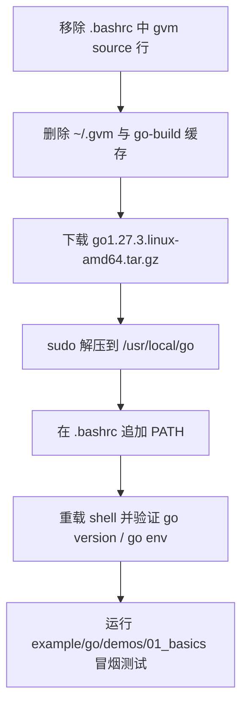

# 清理 gvm 并安装官方最新版 Go

## 目标与范围

清除当前由 gvm 管理的 Go 环境（`~/.gvm`，989M，仅 `go1.23.4`），改用 Go 官方发行包安装最新稳定版 **go1.27.3**（2026-10-19 发布），之后依赖统一由 `go mod` 按官方流程下载，不再引入第三方版本管理器。

本次只改动 WSL2 内的 Linux 环境，不影响 Windows 侧。

## 现状与关键决策

已确认的现状：

| 项目 | 现状 |
|---|---|
| Go 来源 | 仅 gvm，版本 `go1.23.4` |
| `~/.gvm` 体积 | 989M |
| `GOROOT` / `GOPATH` | 分别指向 `~/.gvm/gos/go1.23.4` 与 `~/.gvm/pkgsets/go1.23.4/global` |
| gvm 初始化入口 | `~/.bashrc:140`：`[[ -s "/home/hiyoungman/.gvm/scripts/gvm" ]] && source "/home/hiyoungman/.gvm/scripts/gvm"` |
| `.profile` / `.zshrc` | 无 Go 相关配置 |
| gvm pkgsets 中已装工具 | `global/bin` 不存在，无需要保留的 `go install` 产物 |
| `~/go` | 不存在，无历史模块缓存需迁移 |
| 系统其他 Go | 无（`/usr/local/go`、apt 包均无） |
| 项目现状 | [example/go/demos/01_basics](../../example/go/demos/01_basics) 等 5 个 demo 已使用 `go.mod` |

关键决策：

- 安装位置采用官方默认 `/usr/local/go`，不设自定义 `GOROOT`。
- `GOPATH` 使用默认 `~/go`，`go install` 产物进入 `~/go/bin` 并加入 PATH。
- `GOPROXY` 保持官方默认 `https://proxy.golang.org,direct`，不切换镜像。
- `GOTOOLCHAIN` 保持默认 `auto`：项目 `go.mod` 声明更高版本时由 go 自动下载官方工具链。
- 删除前不额外备份 `~/.gvm`；此目录内容均为可重新获取的 gvm 脚本与 Go 发行版。

实施前提：

- `/usr/local` 写入需要 **sudo 密码**，由用户在执行时手动输入。
- 删除 `~/.gvm` 不可逆。

## 实施任务

- [x] `remove-gvm-init` 移除 `.bashrc` 中的 gvm 初始化行
  - 改动位置：`~/.bashrc:140`
  - 实施动作：删除 `[[ -s "/home/hiyoungman/.gvm/scripts/gvm" ]] && source "/home/hiyoungman/.gvm/scripts/gvm"` 这一行。
  - 完成结果：`.bashrc` 中不再有 gvm 引用，新开 shell 不会加载 gvm。

- [x] `remove-gvm-dir` 删除 `~/.gvm` 与旧构建缓存
  - 改动位置：`~/.gvm`、`~/.cache/go-build`
  - 实施动作：执行 `rm -rf ~/.gvm ~/.cache/go-build`。
  - 依赖：`remove-gvm-init` 完成，避免 shell 启动时报错。
  - 完成结果：`~/.gvm` 不存在，释放约 989M；当前 shell 中 `GOROOT`、`GOPATH` 指向失效（属预期，后续由新配置覆盖）。

- [x] `install-go-official` 下载并解压官方 go1.27.3 到 `/usr/local/go`
  - 改动位置：`/usr/local/go`
  - 实施动作：在 `/tmp` 下载 `https://go.dev/dl/go1.27.3.linux-amd64.tar.gz`；`sudo rm -rf /usr/local/go` 后 `sudo tar -C /usr/local -xzf` 该包；删除压缩包。
  - 完成结果：`/usr/local/go/bin/go` 存在且可执行。

- [x] `configure-path` 在 `.bashrc` 配置 go 与 `~/go/bin` 的 PATH
  - 改动位置：`~/.bashrc` 末尾（拟新增）
  - 实施动作：追加 `export PATH="$PATH:/usr/local/go/bin:$HOME/go/bin"`，带一行注释标明为官方 Go。
  - 依赖：`install-go-official` 完成。
  - 完成结果：新 shell 中 `which go` 指向 `/usr/local/go/bin/go`。

- [x] `verify-go` 验证版本、环境变量并用现有 demo 冒烟测试
  - 改动位置：只读验证，不修改仓库文件
  - 实施动作：执行 `go version`、`go env GOROOT GOPATH GOPROXY`；进入 [example/go/demos/01_basics](../../example/go/demos/01_basics) 执行 `go run .`；全局 `grep` 复查 `gvm` 残留引用。
  - 依赖：`configure-path` 完成，并已重新加载 shell 配置。
  - 完成结果：版本输出 `go1.27.3 linux/amd64`，`GOROOT=/usr/local/go`，`GOPATH=/home/hiyoungman/go`，demo 正常运行，无 gvm 残留。

## 流程图

## 验证方式

按本计划只做轻量校验：版本命令、`go env` 输出、一个现有 demo 的运行结果，以及 gvm 残留引用的 `grep` 检查。不新增测试用例，不运行全量测试。

## 落地结果

- `.bashrc` 中 gvm source 行已移除；`~/.gvm`（989M）与旧 `~/.cache/go-build` 已删除。
- 官方 `go1.27.3` 已解压至 `/usr/local/go`（283M），安装包 SHA256 与 go.dev 公布值一致（`65efbc80...379b40`），`/tmp` 中安装包已清理。
- `.bashrc` 末尾已追加 `export PATH="$PATH:/usr/local/go/bin:$HOME/go/bin"`。
- 校验结果：`go version` 为 `go1.27.3 linux/amd64`；`GOROOT=/usr/local/go`、`GOPATH=/home/hiyoungman/go`、`GOPROXY=https://proxy.golang.org,direct`、`GOTOOLCHAIN=auto`；[example/go/demos/01_basics](../../example/go/demos/01_basics) 的 `go run .` 正常输出。
- 说明：当前 Claude Code 会话仍继承旧 gvm 环境变量，属会话级残留；已在干净环境中模拟新终端验证 `go` 可正常使用。

## 计划落地确认点

- 实施范围：移除 gvm（`~/.gvm` + `.bashrc` 初始化行 + 旧构建缓存），在 `/usr/local/go` 安装官方 go1.27.3，配置 PATH，完成验证。
- 关键决策：删除 `~/.gvm` 不做备份；`GOPROXY`、`GOTOOLCHAIN` 保持官方默认；sudo 密码由用户执行时输入。
- 完成判据：`go version` 为 `go1.27.3`，`GOROOT=/usr/local/go`，`GOPATH=~/go`，现有 demo 可运行，`.bashrc` 无 gvm 引用。
- [x] 用户确认按本计划实施
