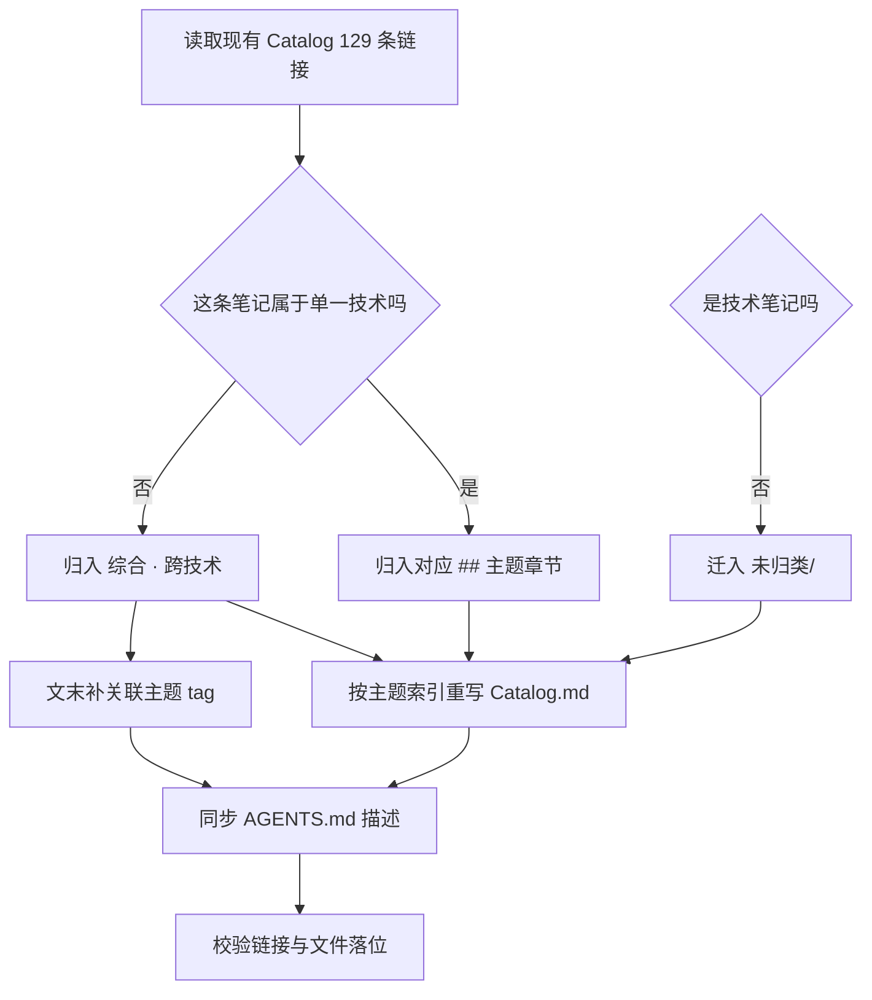

# 按主题索引重构 Catalog

## 目标与范围

把 [Catalog.md](../../Catalog.md) 从「分层分类树」改为「平铺主题索引」：每个可独立检索的技术名占一个章节，章节下直接列出该技术的笔记；跨技术的综合文章集中到 `综合 · 跨技术` 模块，并在条目后标注关联主题、在文末打 tag。

本次取代此前基于 [02_prd.md](../prd/02_prd.md) 的一级/二级/三级分类方案（该方案存在同一层级混用「技术层次」与「语言生态」两套切分标准的问题）。

范围：重写 `Catalog.md`、迁移 15 篇非技术笔记到 `未归类/`、为 15 篇综合文章补 tag、同步 `AGENTS.md` 描述。
不包含：笔记正文改写、`workspace/` 调整、`Hub/` 建子目录、批量补 frontmatter。

## 现状与关键决策

### 已确认的现状

| 项目 | 现状 |
|---|---|
| Catalog 规模 | 406 行，14 个章节，编号 1–10、12、13、16、17（缺 11、14、15） |
| 链接总量 | 129 条，去重 128 条 |
| 悬空链接 | `[[快捷指令]]` 无对应文件，判定为 `[[常用命令&快捷指令]]` 的重复条目 |
| 漏收笔记 | `Hub/调研、试用各类AI产品笔记记录.md`、`tmp/语音识别.md` |
| 笔记总量 | 129 篇：`Hub/` 124（含 `Hub/个人成长/` 7 篇）、`common/` 4、`tmp/` 1 |
| frontmatter | 32/130 篇有，字段为 `type/topic/status/source`，是旧稿重构标记，不含分类信息 |
| Obsidian 插件 | 仅 `mermaid-zoom`，无 Dataview |
| `未归类/` | 已存在且为空 |
| 同名文件 | 无，`[[文件名]]` 链接可随文件移动保持有效 |

### 方案变更与关键决策

| 编号 | 决策 | 理由 |
|---|---|---|
| A | **分类主轴改为主题索引**，不再使用 PRD 的分层分类树 | 分层结构在每次新增笔记时都要求做归类判断，边界模糊处反复纠结；主题索引只需回答「这篇讲什么技术」 |
| B | **46 个技术主题，细粒度**：可独立检索的技术名词独立成节，即使只有 1 篇 | `uv`、`Anaconda` 独立成节后，查什么直接找什么，不需要先推断上位分类 |
| C | **综合文章集中在独立模块**，条目后标注关联主题，文末打 tag | 综合文章不归属单一主题，但仍需可发现 |
| D | **tag 只给 15 篇综合文章加**，不批量补 frontmatter | 专题笔记已被主题标题唯一定位，tag 冗余；只覆盖交叉引用场景，成本与检索噪音都可控 |
| E | **tag 名为受控词表**，与主题标题一一对应，不另造词 | 避免 `#mysql` / `#MySQL` / `#数据库` 并存导致检索失效 |
| F | **tag 写在正文末尾**独立一行 `标签：#xxx #yyy`，不使用 frontmatter | 用户明确不补 frontmatter；Obsidian 原生识别正文 tag |
| G | **`Hub/` 保持扁平**，不建子目录，分类只由 Catalog 表达 | 改分类只需改一个文件；`[[文件名]]` 链接不依赖路径 |
| H | **一级标题使用 `##`**（`#` 留作 `Catalog` 文档标题） | Obsidian 大纲面板中可直接作为导航层级 |
| I | **不渲染无笔记的主题占位标题** | 避免空章节；后续补笔记时再新增 |
| J | **`Common Use` 与 `Temporary Storage` 保留为独立区块**，不拆成技术主题 | 二者是文件位置索引而非技术主题，且 PRD 明确要求 |
| K | **全部 `##` 章节标题使用英文**，含主题、综合模块与未归类区块 | 技术名词本身即英文，标题与 tag 词表可直接对齐；中文只用于笔记正文与说明 |

### 主题索引清单（46 个主题，94 篇）

`##` 标题下直接列笔记。主题按技术域排列，仅用 `---` 做视觉分隔，不引入上层分类标题。标题统一使用英文，不加中文括注。

**语言与前端（10）**

| 主题 | 笔记 |
|---|---|
| `## Python` | Python基础、Python异步编程（asyncio） |
| `## uv` | UV笔记 |
| `## Anaconda` | Anaconda笔记 |
| `## Jupyter` | Jupyter笔记 |
| `## Go` | 01_Go笔记、02_Go基础语法笔记、03_Go复合类型笔记、04_Go函数笔记、05_Go面向对象笔记、06_Go包与工程笔记、07_Go常见问题笔记 |
| `## JavaScript` | 01_JavaScript笔记、02_JavaScript进阶笔记、03_JavaScript异步与模块笔记 |
| `## TypeScript` | TypeScript类型标注与React类型笔记 |
| `## CSS` | 01_CSS笔记、02_CSS选择器与继承笔记、03_CSS盒模型笔记、04_CSS布局笔记、05_CSS单位与值笔记、06_CSS常见问题笔记 |
| `## React` | 01_React笔记、02_React Hooks笔记、03_Zustand状态管理笔记、04_React Router笔记 |
| `## Next.js` | 01–06 Next.js 六篇 |

**后端框架（4）**

| 主题 | 笔记 |
|---|---|
| `## FastAPI` | FastAPI笔记 |
| `## Django` | Django笔记 |
| `## Celery` | Celery笔记 |
| `## Pydantic` | Pydantic笔记 |

**版本控制（1）**

| 主题 | 笔记 |
|---|---|
| `## Git` | 01_Git笔记、02_Git命令速查笔记、03_Git回滚决策笔记、Git Worktree 笔记 |

**数据库（5）**

| 主题 | 笔记 |
|---|---|
| `## MySQL` | 01_MySQL笔记 |
| `## PostgreSQL` | 02_PostgreSQL笔记 |
| `## SQLite` | 03_SQLite笔记 |
| `## MongoDB` | 01_MongoDB笔记 |
| `## Redis` | 02_Redis笔记 |

**向量数据库（3）**

| 主题 | 笔记 |
|---|---|
| `## Milvus` | 01_Milvus笔记 |
| `## Qdrant` | 02_Qdrant笔记 |
| `## zvec` | 03_zvec笔记 |

**中间件（2）**

| 主题 | 笔记 |
|---|---|
| `## RabbitMQ` | 01_RabbitMQ笔记 |
| `## Kafka` | 02_Kafka笔记 |

**基础设施（7）**

| 主题 | 笔记 |
|---|---|
| `## Docker` | 01_Docker笔记、02_Docker镜像与容器笔记、03_Docker数据卷与挂载笔记、04_Dockerfile笔记、05_Docker Compose笔记 |
| `## Kubernetes` | 01_Kubernetes基础笔记、02_Kubernetes部署特性笔记、03_K3s笔记、04_Rancher笔记 |
| `## Harbor` | 05_Harbor笔记 |
| `## Jenkins` | 06_Jenkins基础笔记、07_Jenkins_CICD实战笔记 |
| `## Linux` | 01_Linux基础与文件管理笔记、02_Linux用户权限与组管理笔记、03_Linux进程服务与系统管理笔记、04_Linux磁盘网络与软件包管理笔记、05_Linux定时任务笔记 |
| `## WSL` | WSL笔记 |
| `## Process Management` | 01_进程与服务管理笔记 |

**AI 与机器学习（11）**

| 主题 | 笔记 |
|---|---|
| `## Machine Learning` | 01_ML与DL基础概念笔记、03_深度学习环境安装笔记 |
| `## PyTorch` | 02_PyTorch笔记 |
| `## Large Language Models` | 01_大语言模型笔记、02_推理部署笔记 |
| `## LLM Evaluation` | OpenCompass笔记、EvalScope笔记 |
| `## Prompt Engineering` | Prompt工程笔记 |
| `## RAG` | RAG工业方案笔记、Rerank笔记 |
| `## Agent` | Agent总览笔记、Agent开源项目笔记、mini-agent学习笔记 |
| `## MCP` | MCP笔记 |
| `## Skills` | Skills笔记 |
| `## AI Coding Assistants` | ClaudeCode笔记、Codex笔记、OpenCode笔记、Openclaw笔记 |
| `## Model & Inference Platform` | HuggingFaceTransformers笔记、Ollama笔记 |

**设计（2）**

| 主题 | 笔记 |
|---|---|
| `## Figma` | Figma笔记 |
| `## UI/UX Design` | UI术语与设计风格笔记 |

**计算机基础（1）**

| 主题 | 笔记 |
|---|---|
| `## Computer Networks` | websocket笔记、TCP_IP四层网络模型笔记 |

### Cross-cutting Topics（综合 · 跨技术，15 篇）

在 Catalog 中为 `## Cross-cutting Topics`，置于全部主题之后；条目后以括号标注关联主题（同时作为 tag 的依据）：

| 笔记 | 关联主题 |
|---|---|
| 01_数据库设计相关笔记 | MySQL / PostgreSQL / Redis |
| 04_关系型数据库对比与选型笔记 | MySQL / PostgreSQL / SQLite / MongoDB |
| 03_消息队列对比与选型笔记 | RabbitMQ / Kafka |
| 评测框架对比笔记 | OpenCompass / EvalScope |
| Django+FastAPI秒杀系统课程 | Django / FastAPI / Redis / Celery |
| 08_运维生产方案总览 | Docker / Kubernetes / Harbor / Jenkins |
| 01_DevOps基础与文化笔记 | Docker / Kubernetes / Jenkins / Git |
| 02_小企业DevOps方案笔记 | Docker / Kubernetes / Jenkins |
| 03_DevOps工具链对比笔记 | Git / Docker / Kubernetes / Jenkins |
| 鉴权与登录笔记 | FastAPI / Redis |
| 权限模型笔记 | FastAPI / 鉴权 |
| API网关笔记 | FastAPI / Nginx |
| 上下文工程与Agent笔记 | Agent / MCP / Prompt Engineering |
| 前端工程笔记 | JavaScript / CSS / Next.js |
| 调研、试用各类AI产品笔记记录 | AI Coding Assistants / Model & Inference Platform |

### tag 受控词表

tag 一律小写，英文主题用连字符，中文主题用对应英文名。只用于上述 15 篇综合文章。

| 主题 | tag | 主题 | tag |
|---|---|---|---|
| Python | `#python` | MySQL | `#mysql` |
| uv | `#uv` | PostgreSQL | `#postgres` |
| Anaconda | `#anaconda` | SQLite | `#sqlite` |
| Jupyter | `#jupyter` | MongoDB | `#mongodb` |
| Go | `#go` | Redis | `#redis` |
| JavaScript | `#javascript` | Milvus | `#milvus` |
| TypeScript | `#typescript` | Qdrant | `#qdrant` |
| CSS | `#css` | zvec | `#zvec` |
| React | `#react` | RabbitMQ | `#rabbitmq` |
| Next.js | `#nextjs` | Kafka | `#kafka` |
| FastAPI | `#fastapi` | Docker | `#docker` |
| Django | `#django` | Kubernetes | `#kubernetes` |
| Celery | `#celery` | Harbor | `#harbor` |
| Pydantic | `#pydantic` | Jenkins | `#jenkins` |
| Git | `#git` | Linux | `#linux` |
| Machine Learning | `#machine-learning` | WSL | `#wsl` |
| PyTorch | `#pytorch` | Process Management | `#process-management` |
| Large Language Models | `#llm` | Figma | `#figma` |
| LLM Evaluation | `#llm-eval` | UI/UX Design | `#uiux` |
| Prompt Engineering | `#prompt-engineering` | Computer Networks | `#network` |
| RAG | `#rag` | Agent | `#agent` |
| MCP | `#mcp` | Skills | `#skills` |
| AI Coding Assistants | `#ai-coding` | Model & Inference Platform | `#model-serving` |

### Uncategorized（未归类，15 篇）

在 Catalog 中为 `## Uncategorized`。按 PRD 要求迁入 `未归类/`，末尾保留扁平章节便于导航，不设二级分类。

| 原位置 | 笔记 |
|---|---|
| `Hub/` | Mac使用笔记、投资心得与方法论笔记、Crypto与Web3笔记、量化交易笔记、金融资讯源笔记、天纪—倪海厦笔记、穷鬼出海套餐笔记、代码规范与开发技巧笔记（8 篇） |
| `Hub/个人成长/` | 30天快速成长计划、每日四象限计划表、用7天，真正“认识你自己”、日复盘模版、周复盘模版、建立“人生把控感”的核心框架、有感（7 篇） |

迁移后 `Hub/个人成长/` 变空，删除该目录。

### Common Use 与 Temporary Storage

- `## Common Use`：markdown latex语法大全、工具快捷键、常用命令&快捷指令、技术名词&专有名词（文件在 `common/`）
- `## Temporary Storage`：语音识别（文件在 `tmp/`）

### PRD 已规划但暂无笔记

`html`、`flask`、`sqlalchemy`、`peewee`、`gin`、`chi`、`gorm`、`npm`、`yarn`、`pnpm`、`vue`、`tailwindcss`、`Apache Pulsar`、`harness engineering`、`design and uiux` 的子项。当前不渲染占位标题，补笔记时按主题索引直接新增英文 `##` 章节。

## 实施任务

- [x] `move-unclassified` 将 15 篇非技术笔记迁入 `未归类/`
  - 改动位置：`Hub/` 根目录 8 个 `.md` 与 `Hub/个人成长/` 7 个 `.md` → `未归类/`
  - 实施动作：用 `git mv` 逐个迁移以保留版本历史；迁移完成后删除空的 `Hub/个人成长/` 目录。
  - 完成结果：`未归类/` 恰含 15 篇，`Hub/` 余 109 篇，`Hub/个人成长/` 不存在；wiki 链接因文件名不变继续有效。

- [x] `rewrite-catalog` 按主题索引重写 Catalog.md
  - 改动位置：[Catalog.md](../../Catalog.md) 全文
  - 实施动作：`# Catalog` 下依次写 `## Common Use`、`## Temporary Storage`、46 个英文主题章节、`## Cross-cutting Topics`、`## Uncategorized`；主题间用 `---` 分隔；保留每篇笔记原有的简要说明与 `workspace/` demo 链接；删除重复的 `[[快捷指令]]` 与「系统架构（已并入）」空壳章节；补收 `[[调研、试用各类AI产品笔记记录]]`。
  - 依赖：`move-unclassified` 完成，确保 `未归类` 章节与实际文件一致。
  - 完成结果：Catalog 覆盖全部 129 篇笔记，`##` 章节数 50（2 个区块 + 46 主题 + 综合 + 未归类），悬空链接 0 条。

- [x] `add-cross-tags` 为 15 篇综合文章补关联主题 tag
  - 改动位置：[Hub/01_数据库设计相关笔记.md](../../Hub/01_数据库设计相关笔记.md) 等 15 个文件，正文末尾
  - 实施动作：在每篇文末加独立一行 `标签：#xxx #yyy`，取值严格来自 tag 受控词表与上节「关联主题」列的对应关系；已有「标签：」行的按词表补齐，不重复添加。
  - 依赖：无，可与前两项并行。
  - 完成结果：15 篇综合文章的关联主题均可用 `tag:#xxx` 检索到，tag 无词表外取值。
  - 落地结果：15 篇均已在正文末尾追加 `标签：#…` 行，取值全部来自受控词表。

- [x] `sync-agents-doc` 同步 AGENTS.md 的目录描述与 Catalog 名称
  - 改动位置：[AGENTS.md](../../AGENTS.md) 第 15 行、第 46 行
  - 实施动作：把「速记位于 `速记/`，个人成长位于 `个人成长/`」改为实际结构 `common/`、`tmp/`、`Hub/`、`未归类/`；把「同步更新 `目录.md`」改为 `Catalog.md`；在「笔记重构默认模式」中补充一句：Catalog 采用平铺主题索引、章节标题统一英文，新增笔记按技术名追加到对应 `##` 章节，无对应主题时新增英文标题章节。
  - 依赖：`move-unclassified` 完成。
  - 完成结果：AGENTS.md 描述与仓库实际结构一致，并明确了新笔记的归档方式。
  - 落地结果：目录描述改为 `common/` / `tmp/` / `Hub/` / `未归类/`；`目录.md` 改为 `Catalog.md`；新增平铺主题索引与英文标题的约定。

- [x] `verify-catalog` 校验链接完整性与文件落位
  - 改动位置：只读校验，不修改仓库文件
  - 实施动作：提取 Catalog 全部 `[[...]]` 链接与仓库 `.md` 文件名集合比对，输出悬空项与未收录项；统计 `##` 章节数与主题条目数；核对 `未归类/` 文件数与清单一致；检查 tag 是否全部命中受控词表。
  - 依赖：前三项完成。
  - 完成结果：悬空链接 0 条，未收录笔记 0 篇（`AGENTS.md`、`CLAUDE.md`、`Catalog.md`、`tmp/README.md` 除外），`未归类/` 文件数 15，tag 无词表外取值。

## 流程图

## 验证方式

不新增测试用例。落地后执行一次只读校验：Catalog 的 `[[...]]` 链接与仓库文件名差集为空、`##` 章节数符合预期、`未归类/` 文件数为 15、tag 取值全部命中受控词表。校验脚本临时运行，不写入仓库。

## 落地结果

- 15 篇非技术笔记已用 `git mv` 迁入 `未归类/`，`Hub/个人成长/` 已删除；`Hub/` 由 124 篇降为 109 篇。
- [Catalog.md](../../Catalog.md) 已重写为平铺主题索引：50 个 `##` 章节（`Common Use`、`Temporary Storage`、46 个英文主题、`Cross-cutting Topics`、`Uncategorized`），129 条 wiki 链接全部可解析。
- 15 篇综合文章已在正文末尾追加 `标签：#…` 行，tag 全部命中受控词表。
- [AGENTS.md](../../AGENTS.md) 的目录描述、`目录.md` → `Catalog.md` 引用已同步，并补充了平铺主题索引与英文标题的约定。
- 校验结果：悬空链接 0 条、未收录笔记 0 篇、`未归类/` 15 篇、`Hub/` 109 篇、`##` 章节 50 个、词表外 tag 0 个。
- 未执行：笔记正文内容改写、`workspace/` 调整、`Hub/` 建子目录、批量补 frontmatter。

## 计划落地确认点

- 实施范围：重写 `Catalog.md` 为主题索引（46 个主题 + 综合模块 + 未归类）；15 篇非技术笔记迁入 `未归类/`；15 篇综合文章补 tag；同步 `AGENTS.md`。
- 关键决策：放弃 PRD 分层分类树（A）；细粒度主题，单篇技术也独立成节（B）；综合文章集中并标注关联主题（C）；tag 只覆盖 15 篇综合文章且词表受控（D、E、F）；`Hub/` 保持扁平不建子目录（G）；`Common Use` 与 `Temporary Storage` 保留为区块（J）。
- 完成判据：`Catalog.md` 的 50 个英文 `##` 章节覆盖 129 篇笔记，悬空链接 0 条；`未归类/` 恰含 15 篇，`Hub/` 余 109 篇且 `Hub/个人成长/` 已移除；15 篇综合文章 tag 均命中词表；`AGENTS.md` 描述与实际一致。
- [x] 用户确认按本计划实施
