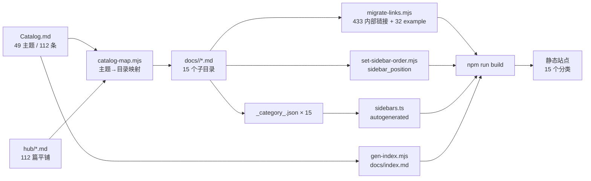

# 标准化 Docusaurus 项目布局

## 目标与范围

把当前自定义布局收敛为 Docusaurus 标准项目布局：

- `hub/` 平铺的 112 篇笔记迁移到 `docs/` 下 15 个技术域子目录
- 侧边栏由目录结构自动生成（`autogenerated` + `_category_.json`），不再由脚本生成配置
- `Catalog.md` 保留在仓库根目录，继续作为跨技术逻辑索引与 agent 导航入口
- `example/` 代码视为仓库静态资源，笔记中的链接改为指向新仓库 `https://github.com/HiRidgewalker/soft-tech-notebook`
- 移除 `static/example/` 同步机制
- `blog/` 不启用（个人知识库不需要）

本次范围只含布局与链接迁移，不重写笔记内容。

## 现状与关键决策

### 已确认事实

- `hub/` 下 112 个 md 文件平铺，无子目录
- `sidebars.generated.ts` 由 `scripts/gen-sidebar.mjs` 从 `Catalog.md` 生成
- `static/example/` 由 `scripts/sync-example.mjs` 复制，共 290 个文件
- 笔记内链接：433 处同目录 `.md` 链接、32 处 `../example/...` 链接、34 处页内锚点
- `Catalog.md` 共 49 个主题、112 个条目，与 112 篇笔记一一对应
- git remote 已指向新仓库，但未携带凭据，无法从命令行验证其可见性

### 目录映射（已用脚本验证覆盖全部 112 篇）

| position | 目录 | 显示名 | 来源主题 | 篇数 |
| --- | --- | --- | --- | --- |
| 1 | `basics` | 基础 | Common Use、Temporary Storage | 3 |
| 2 | `languages` | 编程语言 | Python、Go、JavaScript、TypeScript、CSS | 19 |
| 3 | `frontend` | 前端框架 | React、Next.js | 10 |
| 4 | `backend` | 后端框架 | FastAPI、Django、Celery、Pydantic | 4 |
| 5 | `tooling` | 开发工具 | uv、Anaconda、Jupyter、Git | 7 |
| 6 | `database` | 数据库 | MySQL、PostgreSQL、SQLite、MongoDB、Redis | 5 |
| 7 | `vector-db` | 向量数据库 | Milvus、Qdrant、zvec | 3 |
| 8 | `message-queue` | 消息队列 | RabbitMQ、Kafka | 2 |
| 9 | `devops` | DevOps | Docker、Kubernetes、Harbor、Jenkins | 12 |
| 10 | `linux` | Linux | Linux、WSL、Process Management | 7 |
| 11 | `ai` | AI 与大模型 | Machine Learning、PyTorch、LLM、LLM Evaluation、Prompt Engineering、RAG | 10 |
| 12 | `agent` | Agent 与 AI Coding | Agent、MCP、Skills、AI Coding Assistants、Model & Inference Platform | 11 |
| 13 | `design` | 设计 | Figma、UI/UX Design | 2 |
| 14 | `network` | 网络 | Computer Networks | 2 |
| 15 | `cross-cutting` | 跨技术主题 | Cross-cutting Topics | 15 |

### 关键决策

1. 目录名用英文，`_category_.json` 的 `label` 用中文，兼顾标准布局与阅读体验。
2. 保持 `routeBasePath: '/'`，首页仍为 `docs/index.md`，笔记 URL 形如 `/languages/I_Go笔记`。
3. `Catalog.md` 保留 wikilink 形式（Obsidian 按文件名解析，不受目录影响）；生成 `docs/index.md` 时由脚本换算为带子目录的相对路径。
4. 罗马数字前缀（`I_`、`II_`、`IV_` 等）与阿拉伯数字前缀（`01_`、`02_`）不重命名，改为写入 frontmatter `sidebar_position`，保证目录内排序。
5. `example/` 链接统一改为 `https://github.com/HiRidgewalker/soft-tech-notebook/{blob|tree}/main/example/...`，不再复制到 `static/`。
6. 内部链接按"文件名 → 新路径"映射重算相对路径，锚点原样保留。

### 待确认假设

- 新仓库可能为私有或尚未推送，命令行无法验证；这不影响文件迁移，但链接在未登录环境下会返回 404。

## 实施任务

- [x] `catalog-map` 建立 Catalog 主题到目录的映射
  - 改动位置：拟新增 `../../scripts/lib/catalog-map.mjs`
  - 实施动作：内置 49 主题 → 15 目录的 `GROUPS` 常量；导出 `buildFileMap()`，读取 `hub/*.md`，输出 `文件名 → docs/<group>/<文件名>.md` 的映射；同时提供 `categoryMeta`（目录 → 中文 label、position）
  - 完成结果：运行脚本可打印 112 条映射，无遗漏、无重复（已验证：112 条 / 15 目录）

- [x] `move-docs` 移动 112 篇笔记到 docs 子目录
  - 改动位置：仓库根 `hub/` → 新建 `docs/<group>/`
  - 实施动作：按映射移动文件；移动后删除空的 `hub/`；若目标文件已存在则先报错停止，避免覆盖
  - 依赖：`catalog-map`
  - 完成结果：`docs/` 下 15 个子目录，共 112 个 md；`hub/` 不存在（已验证：112 篇 / 15 目录）

- [x] `rewrite-links` 改写内部链接与 example 仓库链接
  - 改动位置：拟新增 `../../scripts/migrate-links.mjs`，作用于 `docs/**/*.md`
  - 实施动作：
    - 扫描 433 处 `](./X.md)` 与带锚点形式，先用 `decodeURIComponent` 还原文件名，查映射得到绝对目标，再用 `path.relative` 计算新相对路径，重新编码空格
    - 32 处 `../example/...` 改为 GitHub 绝对链接；目录用 `tree`，文件用 `blob`
    - 保留 `#anchor` 部分不做改写
  - 依赖：`move-docs`
  - 完成结果：脚本输出改写数量；抽查跨目录链接正确指向 `../<group>/<file>.md`（已验证：321 处内部链接全部有效，32 处 example 链接已改）

- [x] `category-meta` 为 15 个目录生成 `_category_.json`
  - 改动位置：`docs/<group>/_category_.json`（拟新增 15 个）
  - 实施动作：写入 `label`（中文）、`position`（1–15）、`collapsed: true`
  - 依赖：`move-docs`
  - 完成结果：15 个分类文件齐全，JSON 合法（已验证）

- [x] `sidebar-order` 为带前缀的笔记写入 sidebar_position
  - 改动位置：拟新增 `../../scripts/set-sidebar-order.mjs`，作用于 `docs/**/*.md` 的 frontmatter
  - 实施动作：解析 `^(I{1,3}|IV|V|VI{1,2})_` 与 `^(\d+)_` 前缀并映射为数字；已有 `sidebar_position` 时不覆盖；无前缀文件不写入，按文件名排序
  - 依赖：`move-docs`
  - 完成结果：`languages/go`、`devops`、`linux` 等目录内罗马数字顺序正确（已验证：51 篇写入，61 篇无前缀跳过）

- [x] `sidebar-autogen` 侧边栏改为目录自动生成
  - 改动位置：新建 `../../sidebars.ts`；删除 `sidebars.generated.ts`、`scripts/gen-sidebar.mjs`
  - 实施动作：`sidebars.ts` 导出 `{notebookSidebar: [{type: 'autogenerated', dirName: '.'}]}`
  - 依赖：`category-meta`、`sidebar-order`
  - 完成结果：侧边栏完全由目录与 frontmatter 决定

- [x] `index-gen` 首页生成脚本适配新路径
  - 改动位置：修改 `../../scripts/gen-index.mjs`
  - 实施动作：先扫描 `docs/**/*.md` 建立文件名 → 相对路径索引；解析 `Catalog.md` 的 `##` 与 `[[...]]`；输出到 `docs/index.md`，链接使用带子目录的相对路径；保留 `slug: /` 与 `sidebar_position: 0`
  - 依赖：`move-docs`、`rewrite-links`
  - 完成结果：`docs/index.md` 生成成功，所有条目链接可达

- [x] `example-static` 移除 example 静态资源同步
  - 改动位置：删除 `../../scripts/sync-example.mjs`、`../../static/example/`；修改 `../../package.json`
  - 实施动作：移除 `sync:example` 脚本，`prestart` / `prebuild` 只保留 `gen`；`static/` 只保留 favicon 等真实静态资源
  - 依赖：`rewrite-links`
  - 完成结果：构建不再复制 `example/`，`static/example` 不存在

- [x] `config-update` 更新 Docusaurus 配置
  - 改动位置：`../../docusaurus.config.ts`
  - 实施动作：`docs.path` 改为 `'docs'`；`sidebarPath` 改为 `'./sidebars.ts'`；`onBrokenLinks` 恢复 `'warn'`；`markdown.hooks.onBrokenMarkdownLinks` 恢复 `'warn'`；保留 `numberPrefixParser: false` 与 `routeBasePath: '/'`
  - 依赖：`move-docs`、`sidebar-autogen`
  - 完成结果：配置与标准布局一致，构建可发现真实断链（已验证：构建成功、无断链）

- [x] `docs-align` 同步 AGENTS.md、README 与忽略规则
  - 改动位置：`../../AGENTS.md`、`../../README.md`、`../../.gitignore`
  - 实施动作：
    - AGENTS.md：更新仓库定位、笔记目录 `docs/`、链接规范（跨目录相对链接、example 用仓库链接）、Catalog 仍为根索引
    - README.md：更新目录结构表与维护流程
    - .gitignore：移除 `static/example/`，保留 `docs/index.md`
  - 依赖：`config-update`
  - 完成结果：文档描述与实际布局一致

- [x] `verify-build` 构建验证与链接抽查
  - 改动位置：无文件改动（仅验证）
  - 实施动作：执行 `npm run build`；检查 broken links 警告；抽查 Go→Docker、React→CSS、Agent→MCP 三条跨目录链接；确认侧边栏 15 个分类及顺序
  - 依赖：`config-update`、`index-gen`、`docs-align`
  - 完成结果：构建成功，无 broken links，侧边栏分类与顺序正确

## 流程图

## 验证方式

本次不新增测试任务，采用轻量校验：

1. `npm run build` 必须成功，且不出现 broken links / broken anchors 警告
2. 抽查 3 条跨目录链接的改写结果
3. 检查 `docs/` 下文件总数仍为 112
4. 检查侧边栏分类数量为 15、顺序与映射表一致

## 落地结果

- `docs/` 下 15 个技术域子目录，112 篇笔记全部迁移，`hub/` 已移除
- 321 处内部链接改写完成，全量校验 0 失效；33 条跨目录链接形态为 `../<group>/<file>.md`
- 32 处 example 链接改为新仓库绝对链接
- 15 个 `_category_.json` 生成，侧边栏 16 项（首页 + 15 分类），顺序与映射表一致
- `sidebars.ts` 改为 autogenerated，`sidebars.generated.ts` 与 `gen-sidebar.mjs` 已删除
- 首页 `docs/index.md` 由 Catalog.md 生成，112 条链接全部有效
- `static/example` 与 `sync-example.mjs` 已移除；新增 `static/img/favicon.svg`
- `npm run build` 成功，无 broken links / broken anchors

遗留：`showLastUpdateTime` 对未纳入 git 的 `docs/index.md` 会输出一条警告，不影响构建。

## 后续调整：Catalog 驱动的目录结构

落地后用户追加要求：目录严格以 `Catalog.md` 为唯一来源——`# Catalog` 为一级、`## 主题` 为二级目录、主题下的 `[[笔记]]` 为文章，目录名与章节名保持一致。

- 新增 `scripts/lib/theme-map.mjs`：解析 `Catalog.md`，主题标题转 slug（`Next.js` → `nextjs`、`AI Coding Assistants` → `ai-coding-assistants`），校验 slug 冲突与未归类笔记
- 新增 `scripts/migrate-to-catalog.mjs`：97 篇 docs 笔记迁入 `docs/catalog/<slug>/`，删除原 15 个分类目录，生成 49 个 `_category_.json`（Catalog 根 + 48 个主题）
- 新增 `scripts/rewrite-catalog-links.mjs`：改写 259 条 docs 内部链接、35 条 blog 站内路由为 `/catalog/<slug>/<name>`，0 条未解析
- 侧边栏变为三级：Catalog → 主题（48 个）→ 文章
- 移除已失效的旧迁移脚本：`lib/catalog-map.mjs`、`gen-category-meta.mjs`、`migrate-layout.mjs`、`migrate-links.mjs`、`migrate-to-blog.mjs`
- README.md 与 AGENTS.md 同步为 `docs/catalog/<slug>/` 结构
- 验证：`npm run build` 成功，`build/catalog/` 下 48 个主题目录，`build/catalog/go`、`build/catalog/nextjs` 等路由可访问

追加修正：用户要求取消 `Catalog` 包装层——`# Catalog` 只是文档标题，`##` 主题直接作为 `docs/` 下的一级目录。

- 48 个主题目录由 `docs/catalog/<slug>/` 上移到 `docs/<slug>/`，删除 `docs/catalog/_category_.json`
- 路由由 `/catalog/<slug>/<name>` 变为 `/<slug>/<name>`；35 条 blog 站内链接同步去掉 `/catalog` 前缀
- docs 内部相对链接不受影响（同级目录整体上移，相对关系不变）
- 侧边栏两级：首页 + 48 个主题 → 文章，无 Catalog 节点
- `scripts/lib/theme-map.mjs` 默认目标目录改为 `docs`；`migrate-to-catalog.mjs`、`rewrite-catalog-links.mjs` 随旧布局一并移除
- 验证：`npm run build` 成功，`build/go`、`build/nextjs` 等 48 个主题路由可访问，侧边栏顶层 49 项（首页 + 48 主题）

## 计划落地确认点

- 实施范围：`hub/` → `docs/` 15 个子目录；侧边栏改为自动生成；`Catalog.md` 保留；`example/` 改为新仓库链接；移除 `static/example` 同步
- 关键决策：目录名英文 + 中文 label；首页仍为 `docs/index.md`；`Catalog.md` 保留 wikilink；示例代码链接指向新仓库；`blog/` 不启用
- 完成判据：构建成功、112 篇笔记全部可达、侧边栏 15 个分类顺序正确、无内部断链
- [x] 用户确认按本计划实施
